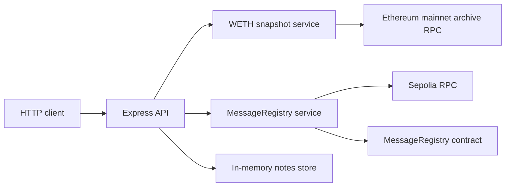

# Web3 Backend Engineering Lab

[](https://github.com/babymakh2026-maker/web3-backend-engineering-lab/actions/workflows/ci.yml)
[](LICENSE)
[](package.json)

A clean-room TypeScript portfolio project that joins deterministic Ethereum
reads, an authenticated testnet write path, and conventional REST API design in
one small backend service.

## Capabilities

| Module | Engineering focus | Public evidence |
| --- | --- | --- |
| Fixed-block WETH snapshot | ABI-safe historical reads, exact integer serialization, controlled provider errors | Ethereum block `20,000,000` |
| MessageRegistry integration | Solidity compilation, deployment, auth boundary, simulation, receipt confirmation, read-after-write | [Sepolia contract](https://sepolia.etherscan.io/address/0xd1E96b9Dbd6168aa1d0baEB50eE65FeCf788B9d5) and [API write](https://sepolia.etherscan.io/tx/0x1727fc2d2f26d52d63bfcdc404d10b58d655f3044f5d736cd57415925c566e1f) |
| Notes REST API | Strict request schemas, stable errors, complete CRUD semantics, deterministic IDs | 12 automated tests across the service |

## Architecture



The write route uses a constant-time token comparison before the signer is
reached. The service then simulates the contract call, submits it, waits for two
confirmations, and verifies the resulting state. See
[the architecture notes](docs/ARCHITECTURE.md) for the boundaries and tradeoffs.

## API Surface

| Method | Path | Purpose |
| --- | --- | --- |
| `GET` | `/health` | Process health |
| `GET` | `/api/v1/ethereum/weth-snapshot` | Four WETH9 values at a fixed block |
| `GET` | `/api/v1/contracts/message-registry` | Current Sepolia contract state |
| `POST` | `/api/v1/contracts/message-registry` | Authenticated contract update |
| `GET/POST` | `/api/v1/notes` | List and create notes |
| `GET/PUT/DELETE` | `/api/v1/notes/{id}` | Read, replace, and delete a note |

The complete request and response contract is available in
[OpenAPI 3.1 format](docs/openapi.yaml) and in the [API guide](docs/API.md).

## Run Locally

Requirements: Node.js 20 or newer and npm 10 or newer.

```bash
npm ci
npm run verify
npm run dev
```

The API listens on `http://127.0.0.1:5025`. Public read endpoints and Notes work
without credentials. Contract writes stay disabled unless both
`PORTFOLIO_SIGNER_PRIVATE_KEY` and `PORTFOLIO_WRITE_TOKEN` are present in the
process environment.

```bash
npm run demo
npm run contract:verify
```

`npm run demo` exercises the read-only blockchain flow and Notes API. Supplying
the two write variables also performs a Sepolia transaction. Never commit those
values or place real funds in the documented testnet wallet.

## Verification

`npm run verify` is the same deterministic gate used in CI:

- ESLint with zero warnings
- TypeScript type checking
- Node test runner integration tests
- Production build
- Repository privacy and credential scan

The Solidity compiler version, optimizer settings, deployment receipt, runtime
bytecode comparison, and owner check are captured by `npm run contract:verify`.
Deployment metadata lives in [deployments/sepolia.json](deployments/sepolia.json).

## Public Boundary

This repository was authored independently with fresh Git history. It contains
no proprietary source, assessment text, credentials, private endpoints, or
assets from an employer or client. The documented wallet is dedicated to
Sepolia and its secret material is stored outside the repository. See
[Project Origin](docs/ORIGIN.md) and [Security Policy](SECURITY.md).
