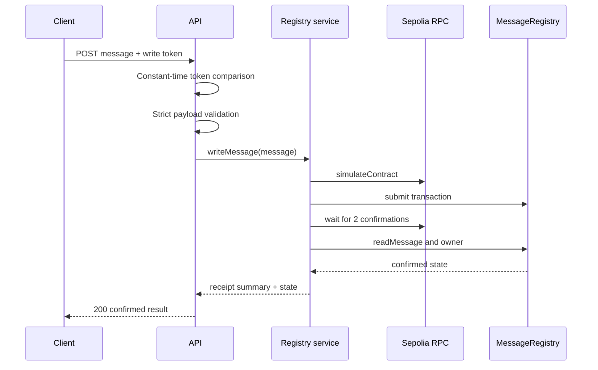

# Architecture

## Service Boundaries

The HTTP layer owns protocol concerns: routing, authorization, payload parsing,
status codes, and stable error envelopes. Domain services own blockchain
interaction and state verification. Adapters isolate `viem`, which keeps unit
and integration tests independent of public RPC availability.

The Notes module is intentionally in memory. Its purpose is to demonstrate HTTP
semantics and deterministic behavior without presenting a database as a hidden
runtime dependency. Restarting the process resets note state.

## Ethereum Snapshot

The snapshot service calls WETH9 at Ethereum block `20,000,000`. Reads are made
sequentially because public archive providers commonly enforce conservative
request limits. Integer values are serialized as decimal strings where JSON
cannot represent them safely.

## Contract Write Path

The signer is optional at startup. Public reads remain available when it is not
configured, while writes fail closed. The API token protects the HTTP boundary;
the contract's immutable owner check independently protects the chain boundary.

## Reproducibility

Solidity compilation pins `solc` and records optimizer and metadata settings.
The verifier masks only compiler-declared immutable byte ranges before comparing
the deployed runtime code with the local artifact. It separately checks chain
ID, receipt success, deployment block, and owner address.

## Production Extensions

For a production service, replace the Notes store with a transactional database,
move the signer to a managed key service, apply rate limiting at the edge, use
authenticated RPC providers with failover, and add distributed tracing. Those
concerns are deliberately kept outside this focused portfolio implementation.
